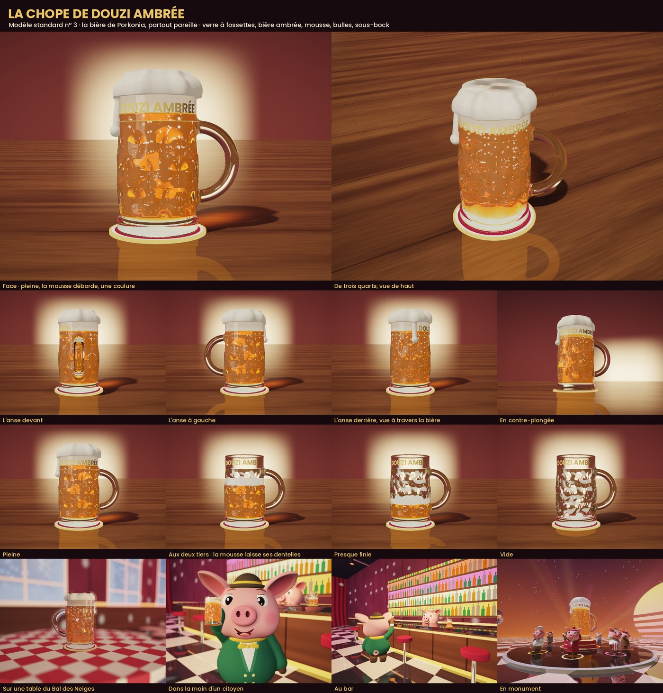

# Moteur 3D Porkonia

Le moteur d'images de synthèse du film « 24 heures à Porkonia » (novembre 2026) : un lancer de rayons sur champs de distance, écrit en C, sans aucun logiciel 3D ni image générée. Tout ce qu'on voit est calculé par ce code.

État au 15 novembre 2026 : sept séquences rendues et montées (le Porc couronné, la Grande Parade, le Cube de Porc, la Douzi Ambrée, la nuit du Gras-Fond II, Douzi City, le lever du soleil), plus le film entier de 4 min 39.

Les règles de fond (ton, canon, ce que Kenny a validé) sont dans la compétence personnelle `porkonia-3d`. Ce dossier ne contient que le moteur et son mode d'emploi.

## Installer et compiler

Les scripts de montage attendent les outils de la chaîne dans `/home/claude/channelpork/` (pork_look, pork_vhs2, pork_vhs3, pork_intro, pork_tape_audio : voir la compétence `channel-pork-video`) et la police Poppins dans `/usr/share/fonts/truetype/google-fonts/`.

```sh
cp -r moteur-3d /home/claude/porkonia3d && cd /home/claude/porkonia3d
python3 tex.py        # l'atlas de textes : txt.bin et tex.h
./buildc.sh           # assemble filmc.c et compile ./filmc (OUT=filmc2 ./buildc.sh pour un binaire d'essai)
```

Vérifié le 15 novembre 2026 : recompilé depuis ce dossier, le binaire rend des trames identiques à l'octet près à celles du film.
Depuis le 16 novembre 2026 (accueil de la chope standard) : identiques à l'octet près pour la fête à bord, Douzi City et le Porc couronné ; pour les séquences de jour et de nuit, 0 à 30 pixels par trame (sur 165 888) changent d'arrondi, parce que le compilateur ordonne autrement les calculs. Invisible, mais un plan retouché se re-rend en entier, pas trame par trame.

## Les fichiers

| Fichier | Rôle |
|---|---|
| `pork3d2.c` | Le socle : maths, primitives, textures de texte, et les scènes du premier film |
| `film_body_part1.c`, `party_geo.c`, `party_shade.c`, `mkpart2.py` | Le corps du moteur (boucle de rendu par trames, anticrénelage, profondeur de champ, halo, tonalité) et la fête à bord du premier film |
| `citizen.h` | Le citoyen standard : un cochon debout, articulé, habillé. La base de tous les personnages |
| `porc4.h` | Le porc de marche à quatre pattes. **Figé : ne jamais changer sa forme ni ses couleurs** |
| `chope.h`, `chope_hote.c` | La chope de Douzi Ambrée, modèle standard n° 3 : **toute bière à l'image est cette chope**, jamais un cylindre. Voir « La chope standard » |
| `city_geo.c`, `city_shade.c`, `mkcity.py` | Douzi City à 05 h 00 (T0 = 200) |
| `w24_geo.c`, `w24_shade.c`, `mk24.py` | Les séquences de jour et de nuit : un cadre commun et une scène par séquence |
| `tex.py` | Les textes gravés ou peints dans les décors (atlas de champs de distance), y compris les enseignes du clip (DJ VITEAU, SOUS LA NEIGE, BAL DES NEIGES) |
| `buildc.sh` | Enchaîne mkpart2, mkcity, mk24, puis gcc |
| `tsw.sh`, `obs.py`, `obf.py` | Images d'essai : une trame par instant, en planches |
| `seqpost.py`, `city3_post.py` | Montage d'une séquence : intro, titrages, effet magnétoscope, NO SIGNAL |
| `filmpost.py`, `film_queue.sh` | Montage du film entier, par tronçons, puis collage |
| `music3.py`, `seqaudio.py`, `*_audio.py` | La musique et les bruitages, synthétisés en numpy |
| `pilot_*.py`, `acte5_*.py`, `acte5b_*.py` | L'acte V de « PORKONIA, LE FILM » (la nuit du Gras-Fond) : voix synthétiques, boîte de dialogue, pièces d'archives dessinées, générique |

## Rendre

```sh
./filmc F0 F1 T0 > trames.rgb     # trames F0 à F1-1, 576 x 288 en rgb24, 50 trames par seconde
```

| T0 | Séquence | Trames |
|---|---|---|
| 0 | Acte V du film, première partie : la jetée, l'embarquement, la plongée | 2400 |
| 100 | Acte V du film, deuxième partie : la fête à bord | 4025 |
| 200 | Douzi City, 05 h 00 | 2075 |
| 300 | Le Porc couronné, 06 h 00 | 1800 |
| 400 | La Grande Parade, 08 h 00 | 1800 |
| 500 | Le Cube de Porc | 1800 |
| 600 | La Douzi Ambrée, 12 h 00 | 1800 |
| 700 | Le Gras-Fond II et Fatbass | 1800 |
| 800 | Le lever du soleil, le générique | 2500 |

Le montage attend les trames sous ces noms : `mon.rgb`, `par.rgb`, `cub.rgb`, `tav.rgb`, `gf.rgb`, `fin.rgb`, et `dc3.rgb` pour Douzi City. Une séquence complète, par exemple la taverne :

```sh
./filmc 0 1800 600 > tav.rgb      # les images
python3 tav_audio.py              # la musique et les bruitages : tav_audio.wav
python3 seqpost.py tav            # le MP4 de la séquence
```

Le film entier, une fois toutes les séquences rendues et leur son fait : `nohup ./film_queue.sh &` (il enchaîne `python3 filmpost.py 0` à `6`, un tronçon par séquence, puis `audio`, puis `join`).

Un rendu se reprend : les trames s'ajoutent à la suite du fichier. Après une coupure, ramener le fichier à un nombre entier de trames (`truncate -s $((N*497664))`) puis relancer `./filmc N FIN T0 >> trames.rgb`.

Compter 0,5 à 1,2 s par trame sur deux cœurs, soit 20 à 35 min pour 36 s. Le montage d'une séquence prend 5 à 10 min, celui du film entier environ 45 min.

## Voix et boîte de dialogue (« PORKONIA, LE FILM »)

Le film se fait sans voix de synthèse commerciale. `acte5_audio.py` fabrique la voix du narrateur lettre par lettre (une courte syllabe par lettre, deux formants, sans bruit de frappe) et écrit l'instant de chaque lettre dans un fichier `..._subs.json`. `acte5_post.py` s'en sert pour taper le texte au rythme de la voix dans une boîte de dialogue basse et compacte, qui ne cache pas l'image.

Pour une nouvelle scène parlée : copier ces deux scripts, changer `LINES` (instant de début, phrase) et la durée `FILM`.

`acte5_post.py` et `acte5b_post.py` lisent les trames dans plusieurs fichiers (`fields_a.rgb`, `p2_a.rgb`, etc.) : ce sont les morceaux du rendu d'origine. Pour refaire, rendre d'une traite et simplifier `field_full` ou `SRC`.

## Regarder avant de rendre

```sh
T0=500 ./tsw.sh cub 4 13 22 32          # une trame à 4 s, 13 s, 22 s et 32 s : cub_0.png
BIN=./filmc2 T0=500 ./tsw.sh cub 4 13   # avec un binaire d'essai, pendant qu'un rendu tourne
```

Variables d'environnement utiles :
- `WCAM="x y z cx cy cz focale"` : une caméra d'inspection à la place de celle du plan.
- `WDBG` : 1 sans reflets, 2 sans ombres, 4 sans occlusion, 8 sans les personnages placés, 32 l'occlusion seule, 64 les normales, 128 les positions.
- `WPROBE="x0 y0 z0 x1 y1 z1 n"` : imprime la distance et le matériau le long d'un segment, puis s'arrête.

## Écrire une nouvelle séquence

Chaque séquence a un numéro (T0 = 300 + 100 x numéro) et quatre morceaux :
1. Dans `w24_geo.c` : une fonction `xxx_map(p, &m)` qui rend la distance et le matériau, de nouveaux matériaux à la fin de l'énumération `W_...`, et un cas dans `wmap`.
2. Dans `w24_shade.c` : `xxx_material` (couleurs, textes, lumières propres), `xxx_setup(s)` (soleil, ambiance, personnages, lumières ponctuelles, caméras plan par plan), et un cas dans `wsky`, `wfogc`, `wfod`, `wmaterial` et `setupw`.
3. Un script `xxx_audio.py` sur le modèle des autres (durée, mesures de 2,25 s, sections).
4. Une entrée dans `SEQS` de `seqpost.py` (titrages, plis de bande) puis dans `ORDER` de `filmpost.py`.

Les personnages :
- Placés un par un : `WCZ[k]` (le costume, copié d'une des douze silhouettes `CZA[0..11]` ou fait avec `cz_base`), une pose par trame (`cz_rest`, puis `cz_idle`, `cz_walk`, `cz_wave`, `cz_salute`, `cz_cheers`), et `w_place(k, x, y, z, cap)`. Le cap 0 regarde vers +z.
- En foule : une grille dont chaque case tire sa silhouette et sa pose au hasard (voir `par_fan`, `cub_ring`, `gf_fan`).
- Un citoyen mesure environ 1,3 m, ses bras portent à 0,35 m : rapprocher le comptoir, la manette ou la platine plutôt que d'étirer le bras. Pour l'asseoir, avancer les pieds de 15 cm et poser un tabouret de 24 cm.

## La chope standard



Demande de Kenny du 16 novembre 2026 (« à chaque fois tu fais juste un cylindre moche ») : la bière de Porkonia a un modèle, comme le citoyen et le porc de marche. `chope.h` contient le modèle (verre à fossettes, pied épais, anse, Douzi Ambrée, mousse qui déborde, coulure, bulles, buée, dentelles de mousse, sous-bock, marque imprimée en or) et son optique (réfraction verre et bière, réflexion totale, absorption : mince la bière est dorée, épaisse elle est ambrée). `chope_hote.c` la branche dans le moteur : jusqu'à six chopes par image.

Dans le `xxx_setup(s)` d'une séquence, à chaque trame :

```c
ch_put(V(x, y, z), 1.5f, lacet, inclinaison, fill, foam, cold, lace, drip, 1);
```

- `V(x, y, z)` : le point où le verre touche son support. Le dernier argument à 1 ajoute le sous-bock, dessous.
- Échelle : 1 = taille réelle (16,5 cm). **1,5 dès qu'elle est près d'un citoyen ou dans sa main** (leurs têtes sont grosses, à 1 elle paraît minuscule), 10 pour une image de studio, 24 pour un monument.
- Lacet 0 : l'anse vers +x, la marque face à -z. Inclinaison : pour trinquer.
- `fill` 0 vide à 1 pleine ; `foam` hauteur de mousse (elle déborde au-dessus de 0,55 quand la chope est pleine) ; `cold` buée et gouttes ; `lace` dentelles de mousse au-dessus du niveau, quand on a bu ; `drip` la coulure.
- Dans une main : après `ch_put`, `chi_t *I = &CHI[NCH - 1]; I->pos = sub(main, mul(add(mul(I->ex, 0.090f), mul(I->ey, 0.083f)), échelle));` (le milieu de l'anse dans la main).

Rien d'autre à faire : `wmap` ajoute les chopes à la scène, `wshade` appelle leur optique (matière `W_CHOPE`), `wlight` ajoute la lueur d'ambre au pied d'une chope pleine, et `setupw` les retire à chaque trame. Les anciennes chopes cylindriques de la taverne (`W_MUGH`) et des citoyens (`PROP_MUG`) restent dans les films déjà rendus ; toute nouvelle scène prend la chope standard.

Ne pas changer sa forme ni ses couleurs sans que Kenny le demande : on règle le remplissage, la mousse, la taille.

Coût : une chope qui remplit l'image double à peu près le temps de la trame (l'optique relance des rayons dans la scène) ; posée au loin, elle ne coûte presque rien.

## Pièges rencontrés

Champs de distance :
- Une borne ne doit jamais dépasser la vraie distance. Dehors d'une zone, rendre la distance à la zone plus une marge, et garder les objets à plus que cette marge du bord. Une borne trop petite au loin devient un plan fantôme.
- Dans une grille, borner le pas par la distance au bord de la case, mais pas vers l'extérieur des rangées du bord, sinon la borne devient négative.
- Une surface bosselée par une formule n'est plus une vraie distance : multiplier par 0,8, sinon le rayon perpendiculaire s'enfonce dans la surface et l'occlusion y dessine une tache ronde.
- Sous un personnage, l'occlusion voit ses sphères englobantes et dessine un disque : élargir `CZ_BND` pendant le calcul de l'occlusion.
- Un objet de 120 m sort de la portée des rayons d'ombre : calculer son ombre à part, par intersection avec sa boîte.

Image :
- L'or qui reflète un ciel bleu vire au vert : désaturer le reflet.
- Un comptoir ciré qui reflète ce qui pend au plafond montre des objets incompréhensibles : baisser le reflet et troubler la normale.
- Un texte ou un afficheur fin disparaît à 576 x 288 : le grossir, épaissir les segments.
- La profondeur de champ donne des reflets carrés sur les petits points brillants en très gros plan : fermer le diaphragme.
- Pas de stroboscope ni de clignotement rapide : faire battre les lumières en douceur.

Mise en scène :
- Montrer les visages : un travelling arrière face aux marcheurs vaut mieux qu'une file vue de dos.
- Le titrage occupe le bas à gauche : y placer des figurants, jamais le sujet du plan.
- Une foule qui tourne doit boucler (une coordonnée le long du périmètre). Si elle doit apparaître ou disparaître, le faire dans un porche sombre.
- Vérifier la route de la caméra contre les statues, les tables et la foule. La limite d'une foule peut changer d'un plan à l'autre, à la coupe.
- Avant d'inventer un détail, chercher dans la bible : le guide, le registre et « celui qui refait le tour » du Cube en viennent.

Conduite du travail :
- Les programmes lancés en arrière-plan meurent quand la réponse se termine : rester actif jusqu'au bout, rendre par morceaux qu'on peut reprendre, monter par tronçons.
- Deux cœurs seulement : un essai pendant un rendu le ralentit. Compiler les essais sous un autre nom.
- Pour enchaîner des tâches, écrire un script de file d'attente : une boucle `pgrep -f` tapée à la main peut se reconnaître elle-même et ne jamais finir.

## Le clip « Sous la neige de Douzi City », le Danseur et les nouveaux citoyens (16-17 novembre 2026)

Le clip musical de DJ Viteau (4 min 28, 63 plans, rendu par trames 50 Hz) s'ajoute au moteur du film sans toucher à `filmc` : `buildclip.sh` construit un second binaire, `./filmclip` (`HD=1 ./buildclip.sh` construit aussi `filmclip_hd`, en 1152 x 576 par trame, pour les images fixes).

```sh
python3 tex.py && ./buildclip.sh
CLIP="ts dur e th pat var mult s0" ./filmclip F0 F1 T0      # T0 = 900 + 100 x numéro de plan ; trame f = instant f / 50 - 1 s dans le plan
./thd.sh essai "48 1 0 4 0 0 0 9"                            # une image fixe HD (dans /home/claude/clip/chope/)
./tclip.sh essai "42 2.0 66.0 5.3 0.8 0 0 0" ...             # des trames 576 x 288 en planches
./po.sh affiche.png                                          # l'affiche des Ranga Boyz (plan 50), en portrait 1080 x 1440 (binaire filmclip_po)
```

| Fichier | Rôle |
|---|---|
| `clip_geo.c`, `clip_shade.c`, `mkclip.py`, `buildclip.sh` | Les décors du clip (le Bal des Neiges, Douzi City sous la neige, le studio, la scène aux néons de l'affiche), les danses, les foules, et un plan par numéro (`clip_setup`) |
| `danseur.h`, `danseur_mat.h` | Le Danseur : un porc humanoïde à squelette (bassin, buste et tête indépendants, bras et jambes par cinématique inverse). Le corps élancé est celui de **Martin Plaisir**, à lui seul. Les proportions se règlent (jambes, bras, épaules, buste, membres, ventre) : la bibliothèque `DNBODY` de `clip_shade.c` en garde huit (compact, grosse tête, boule à tuyaux, bedaine, armoire = John Pork, mini, poire, teckel) |
| `clip/clip_edl.py`, `clip/clip_render.py`, `clip/clip_post.py` | Le découpage (63 plans calés sur les temps de la musique), le rendu reprenable plan par plan, le montage (intro, titrages, Porko Effect, NO SIGNAL). Ils attendent l'espace de travail en `/home/claude/porkonia3d` et `/home/claude/clip`, avec la musique `song.wav`, qui n'est pas dans ce dépôt |
| `clip/affiche_ranga.py` | Le montage de l'affiche (halo des néons, titres) |

Ce qui a changé dans `citizen.h` et `w24_shade.c` (valable pour tous les films) :
- Cheveux : sept coupes de tous les jours en plus (court, raie de côté, longs, bouclettes, queue de cheval, gominé, couronne chauve) et celles des Ranga Boyz. Une coupe s'amincit jusqu'à rien à la ligne du front, sinon elle se lit comme un béret.
- Le sourire est plus petit et plus doux (l'ancien, trop large, faisait peur), et la bouche ouverte ne se superpose plus au sourire.
- Les mains : une paume de peau, deux doigts potelés recourbés, des ongles de sabot (`C_NAIL`) et un ergot. Les pieds : des sabots fendus, ou des baskets (`F_SHOES`, couleur `cshoe`). Le satin pailleté (`F_SEQUIN`) pour les vestes et les pantalons de scène.
- Les bras ne passent plus dans le ventre ni dans les joues ; le rose des pommettes se dose selon la clarté de la peau.
- L'ombre sur les personnages (`shadow_cz` dans `w24_shade.c`) avance à pas fins et donne une pénombre douce : les gros pas de `shadow()` faisaient des taches brunes dures sur les visages.

Conséquence : les séquences déjà rendues du film « 24 heures à Porkonia » ne se recalculent plus à l'identique (mains, bouches, ombres sur les citoyens). Pour retrouver exactement l'ancien rendu, reprendre `citizen.h` et `w24_shade.c` du commit f4d4414.

## Ce qui reste à faire

- Le montage (`seqpost.py`, `filmpost.py`) utilise encore l'habillage Channel Pork de novembre 2026 : titrages dans un bandeau bordeaux, compteur de magnétoscope tout du long, ancienne intro. La chaîne s'appelle Canal Pork depuis le 14 novembre 2026 et son habillage a changé. Brancher le nouvel habillage avant toute nouvelle livraison.
- Dans le film entier, la musique coupe net à chaque changement de séquence.
- La musique est synthétisée et n'a jamais été écoutée.
